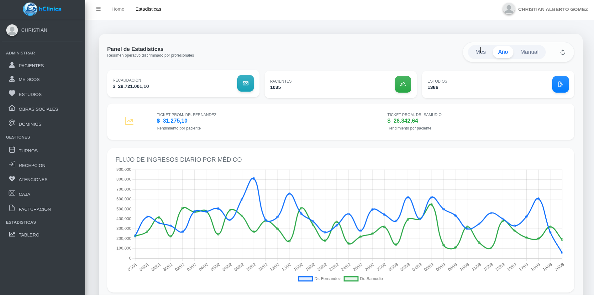

# Hola, soy Christian Alberto Gomez 👋

### Analista Universitario de Sistemas | Java Backend Developer

Soy un desarrollador apasionado por el Backend, radicado en **Resistencia, Chaco, Argentina 📍**. Actualmente cursando el 5to año de Ingeniería en Sistemas de Información (UTN), me especializo en crear soluciones robustas, seguras y escalables utilizando el ecosistema de Java y Spring. 

---

### 🛠️ Tecnologías y Herramientas

**Backend & Arquitectura**
 

**Bases de Datos & DevOps**
 

**Frontend**
 

---

### 🚀 Sistemas Destacados (Comerciales)

Actualmente desarrollo y comercializo soluciones de software a medida:

|  |  |
| :---: | :---: |
| **📦 MiStock** | **🏥 hClinica** |
| Sistema integral para la gestión de inventarios y control de stock. Facturación Electrónica (ARCA). Desarrollado con Spring Boot y PrimeFaces. | Software de gestión médica y clínica para turnos, historias clínicas y envios de informe por correo/whatsapp. |
| [Ver Proyecto/Demo](#) | [Ver Proyecto/Demo](#) |

---

### 🎓 Proyectos Académicos Destacados - UTN

<b>1. 🐳 Arquitectura Microservicios & DevOps (Event-Driven)</b>

 
Diseño y despliegue de una arquitectura orientada a eventos resolviendo el flujo de creación de tareas mediante el patrón Pub/Sub.

*   **Tecnologías:** `Java 17/21` `Spring Boot` `Apache Kafka` `Docker` `Prometheus` `Grafana`
*   **Logros:** Creación de red virtual interna (`devops-net`), resolución de service discovery, y observabilidad con Micrometer.
*   **CI/CD:** Pipeline automatizado en GitHub Actions para compilación, containerización y push a Docker Hub.
*   🔗 [Ver Repositorio](https://github.com/chrgomez/devops-event-driven)

<b>2. ⚙️ Pipeline CI/CD - API Gestión de Tareas</b>

 
Implementación de un entorno de Integración Continua (CI) para automatizar validaciones de código y notificaciones.

*   **Tecnologías:** `Spring Boot 3` `JUnit 5` `H2 Database` `GitHub Actions` `Slack Webhooks`
*   **Logros:** Automatización del flujo de trabajo: al hacer `git push`, el pipeline ejecuta tests en memoria, compila el artefacto `.jar` y envía notificaciones de éxito/fallo a un canal de Slack.
*   🔗 [Ver Repositorio](https://github.com/chrgomez/ic-api) 

<b>3. 🌍 Entorno SIG (Sistemas de Información Geográfica)</b>

 
Implementación de un entorno espacial base de datos/cliente.

*   **Tecnologías:** `PostgreSQL` `PostGIS` `QGIS`
*   **Logros:** Configuración de bases de datos espaciales y habilitación de extensiones `plpgsql`. Diseño de arquitectura para que múltiples usuarios manejen workspaces locales independientes conectados a un mismo motor.
*   🔗 [Ver Repositorio](https://github.com/chrgomez/sig)

---

### 📊 Mis Estadísticas

---

### 📫 Contacto

